<p align="center">
  
</p>

<h1 align="center">Motion Graphics Pro v2.4.2</h1>
<p align="center"><b>Atelier Kertas</b> · a plugin for Claude that takes a motion graphics video from a plain-language brief to a finished file</p>
<p align="center">
  <a href="https://salimmoo.github.io/motion-graphics-pro/"><b>Open the interactive guide ↗</b></a> ·
  <a href="#install"><b>Install</b></a> ·
  <a href="docs/download/motion-graphics-pro-plugin-v2.4.2.zip">Download the plugin</a> ·
  <a href="#free-and-ultra">Free and Ultra</a> ·
  <a href="CHANGELOG.md">Changelog</a> ·
  <a href="LICENSE.md">Licence</a> ·
  <a href="NOTICE.md">Credits</a> ·
  <a href="#bahasa-indonesia">Bahasa Indonesia</a>
</p>

---

You write a brief the way you would talk to a creative team. Claude designs the concept, prepares the assets, animates, checks the quality, then renders on your own computer. You keep the decision at five points: concept, script, cost, first sample and final render.

One Claude plugin with three skills, for explainers, ads, music videos, documentaries and lessons in paper collage, vector, 3D, kinetic type, pixel art or origami styles. The skill docs are in English; Claude replies in your language (fully in Indonesian for Indonesian users, with Indonesian templates). The [guide](https://salimmoo.github.io/motion-graphics-pro/) is bilingual (flag button, bottom left).

| | | | |
|---|---|---|---|
| [](docs/assets/img/galeri/01-atelier-kertas-preview.mp4) | [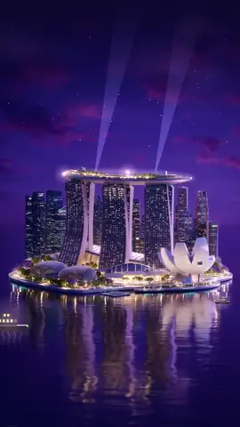](docs/assets/img/galeri/02-singapura-malam-preview.mp4) | [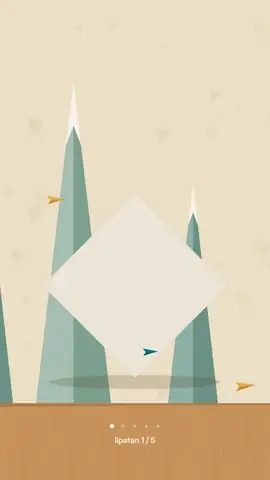](docs/assets/img/galeri/03-origami-preview.mp4) | [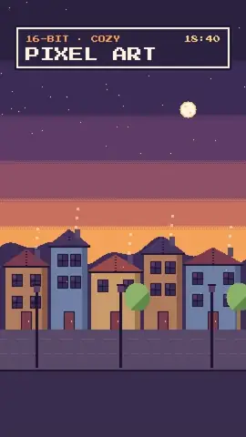](docs/assets/img/galeri/04-pixel-art-preview.mp4) |
| **Atelier Kertas**<br><sub>Layered paper collage, the house style</sub> | **Night city**<br><sub>Isometric Singapore-style skyline, lights alive in code</sub> | **Origami**<br><sub>TRN-03 · a crane that really folds (rigid origami)</sub> | **Pixel art**<br><sub>TRN-02 · cozy 16-bit town</sub> |
| [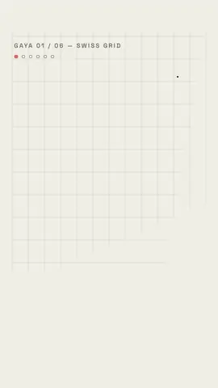](docs/assets/img/galeri/05-teks-kinetik-preview.mp4) | [](docs/assets/img/galeri/06-peta-topografi-preview.mp4) | [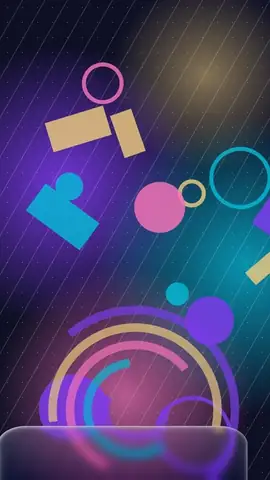](docs/assets/img/galeri/07-liquid-glass-preview.mp4) | [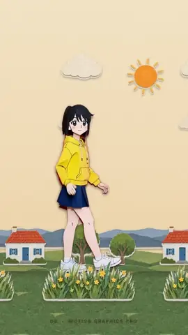](docs/assets/img/galeri/08-tokoh-2d-preview.mp4) |
| **Kinetic type**<br><sub>Six type styles, one per beat</sub> | **Topographic map**<br><sub>Contours + a curved sea route (Natural Earth)</sub> | **Liquid glass**<br><sub>A glass control panel of the skill</sub> | **2D character**<br><sub>Waves, then walks, over paper parallax</sub> |
| [](docs/assets/img/galeri/09-benda-bicara-preview.mp4) | [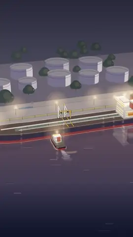](docs/assets/img/galeri/10-simulasi-3d-preview.mp4) | [](docs/assets/img/galeri/11-talking-head-preview.mp4) | [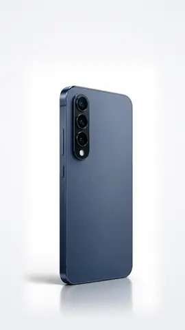](docs/assets/img/galeri/12-hp-realistis-preview.mp4) |
| **Talking object**<br><sub>A hopping coffee cup with visemes from the VO</sub> | **3D simulation**<br><sub>A tanker docking in one 3D take</sub> | **Talking head**<br><sub>Live-action sticker cutout inside a paper world</sub> | **Realistic product**<br><sub>AI photo + video, motion added in code</sub> |

<sub>Every clip above was made with this package (packs, blocks, the motion library, free or AI images, voice cloning), rendered locally. Click a clip for the video.</sub>

## Why Motion Graphics Pro

- **The whole job, not one step.** Brief → concept → script and voice → assets → motion → QC → render, with five decision points where Claude stops for your approval. Most tools cover one of these steps; tutorials usually cover a few.
- **Everything stays editable.** Each video is an HTML composition you (or Claude) can change: move, retime or restyle any layer, swap a block, re-do one sentence of the voice-over. Nothing is locked inside a fixed template.
- **Many looks, not one.** 104 motion packs in 11 categories and 260 blocks: paper collage, vector, isometric, pixel art, origami, kinetic type, maps, 3D, liquid glass and more.
- **Your voice, your images.** Clone your own voice locally (with recorded consent) or use ElevenLabs; generate images free on your own GPU or a free cloud, or use Higgsfield for premium assets.
- **Measured quality.** `mgp curves` checks motion like a graph editor, `mgp audit` checks safe zones, VO errors, loudness, licences and approvals before the render.
- **Local and free to run.** Renders on your own computer; no subscription for the toolkit itself. Paid services are optional and always quoted before use.
- **Bilingual.** English docs; Claude works fully in Indonesian for Indonesian users.

| | Motion Graphics Pro | Typical AI video apps | Code video frameworks (e.g. Remotion, HyperFrames) | Online tutorials |
|---|---|---|---|---|
| From brief to finished file | ✅ Guided, with 5 decision points | ✅ Fast, mostly one-shot | ◐ You build the pipeline | ✗ Partial, step by step |
| Edit any layer, timing or style | ✅ | ◐ Limited to the template | ✅ If you write the code | ◐ Depends on the tool shown |
| Styles out of the box | ✅ 104 packs, 260 blocks | ◐ The app's templates | ◐ Starter templates / registries | ◐ One style per video |
| Voice-over incl. your own cloned voice | ✅ Local or ElevenLabs | ◐ Usually stock voices or paid add-ons | ✗ Bring your own | ✗ |
| Image generation | ✅ Free local/cloud or Higgsfield | ✅ Built in, credits | ✗ Bring your own | ✗ |
| Motion QC and pre-render audit | ✅ `mgp curves`, `mgp audit` | ✗ | ◐ Manual | ✗ |
| Render cost | Your computer, free | Credits / subscription | Free locally; cloud render paid | — |
| You need to code | No (Claude writes it) | No | Yes | Varies |

<sub>The comparison is general and may not fit every product; it describes typical setups, not specific companies' current plans.</sub>

## Install

The package is one **Claude plugin**, `motion-graphics-pro`, holding three skills: `motion-graphics-pro` (production flow), `motion-graphics` (motion principles + JS library) and `vector-character` (characters). Pick the route that matches where you use Claude.

| You use | Route | Renders video? |
|---|---|---|
| claude.ai (web / desktop chat) or Cowork | [A. Upload the plugin](#a-claudeai-or-cowork) | Usually not (the chat sandbox lacks Chrome/ffmpeg); everything else works |
| Claude Code (terminal, desktop Code tab, VS Code, JetBrains) | [B. Install from the marketplace](#b-claude-code) | Yes |
| Any Claude that reads `~/.claude/skills/` | [C. Copy the skills by hand](#c-manual-install-plain-skills) | Yes (with Node, Chrome, ffmpeg) |

**What you need.** Only for rendering and the local engines; writing briefs, concepts and scripts needs nothing extra.

| Needed | For |
|---|---|
| Node.js 22+ | mgp, `motion-graphics/lib/build.js` |
| ffmpeg + ffprobe on PATH | Video and audio encoding, QC (Windows: `winget install Gyan.FFmpeg`) |
| Google Chrome, Microsoft Edge or Chromium | The frame-capture browser (found automatically; `--browser` / `MGP_BROWSER` for another path) |
| Python 3.10+ with numpy + Pillow | Skill scripts (gait, 3D space, shadows, magenta key, cutting) |
| Python 3.10-3.12 + about 15 GB of disk | Optional: the local voice and image engines, installed by `mgp install` (NVIDIA GPU or Apple Silicon if present) |
| Higgsfield and ElevenLabs connectors | Optional: paid AI assets and ElevenLabs voices |

HyperFrames, GSAP, OpenCV and Skia are not needed.

### A. claude.ai or Cowork

1. Download the plugin: [`motion-graphics-pro-plugin-v2.4.2.zip`](docs/download/motion-graphics-pro-plugin-v2.4.2.zip) (≈9.5 MB). **Do not unzip it.**
2. In Claude, open **Settings → Capabilities** and make sure **Code execution** is on.
3. Open **Customize → Plugins**.
4. Click **Upload plugin** and choose the ZIP. As an alternative to steps 1 and 4, click **Add marketplace**, type `salimmoo/motion-graphics-pro`, then install **motion-graphics-pro** from the list.
5. Start a new chat and type a brief, for example *"Make a 15-second 9:16 paper-collage ad for an iced coffee"*. Claude picks the skill by itself, or you can call it directly with `/motion-graphics-pro:motion-graphics-pro`.

In the chat sandbox the brief, concept, script, templates, asset prompts, composition code and Python scripts all work. Rendering needs Node 22+, Chrome/Chromium and ffmpeg, which the sandbox usually lacks; Claude tells you, and you render in Claude Code or on your own computer.

### B. Claude Code

1. Install the tools from **What you need** above if you don't have them (Node.js 22+, ffmpeg, Chrome or Edge, Python 3.10+).
2. Start Claude Code and run:

   ```text
   /plugin marketplace add salimmoo/motion-graphics-pro
   /plugin install motion-graphics-pro@salimmoo
   ```

   From a normal terminal, the same commands are `claude plugin marketplace add salimmoo/motion-graphics-pro` and `claude plugin install motion-graphics-pro@salimmoo`.
3. Run `/reload-plugins` or start a new session.
4. Check that it works: type a brief, or ask *"run mgp doctor"*. Claude runs the bundled CLI and reports your CPU, RAM, GPU, ffmpeg encoders and suggested routes.
5. Optional: install the local engines (step D).

**Update:** `/plugin marketplace update salimmoo`, then `/plugin update motion-graphics-pro@salimmoo` (or turn on auto-update in `/plugin` → Marketplaces).
**Remove:** `/plugin uninstall motion-graphics-pro@salimmoo`. Voice profiles and engines in `~/.mgp` stay until you delete that folder.

### C. Manual install (plain skills)

1. Download the [plugin ZIP](docs/download/motion-graphics-pro-plugin-v2.4.2.zip) and unzip it, or clone this repo.
2. Copy the three folders inside `skills/` (repo: `plugin/skills/`) into your skills folder:
   - macOS / Linux: `~/.claude/skills/`
   - Windows: `%USERPROFILE%\.claude\skills\`

   ```bash
   git clone https://github.com/salimmoo/motion-graphics-pro
   cp -r motion-graphics-pro/plugin/skills/* ~/.claude/skills/
   ```

3. Install the Python basics: `pip install -r ~/.claude/skills/motion-graphics/scripts/requirements.txt` (numpy + Pillow; the same file exists for vector-character).
4. Start a new session and type a brief.

The CLI is `node <motion-graphics-pro skill folder>/render/bin/mgp.mjs` (inside a plugin: `${CLAUDE_SKILL_DIR}/render/bin/mgp.mjs`); `npm link` inside `render/` gives you a global `mgp`. It needs no `npm install`.

### D. Local engines (optional, once per computer)

The **local voice clone** and **local free images** need large models that are **not in the plugin** (voice ≈9 GB, images ≈5 GB, depending on the platform). Claude usually offers this at the start of a project; you can also run it yourself:

```bash
mgp doctor                   # CPU, free RAM, GPU/VRAM, encoders, PyTorch, suggested routes
mgp install all --dry-run    # see the PyTorch build, device and disk space first
mgp install voice --detach   # voice clone (Chatterbox, MIT), downloads in the background
mgp install image --detach   # local images (FLUX.2 [klein] 4B, Apache-2.0)
mgp install cutout           # background removal (rembg + u2net)
mgp install all --status     # progress and status
```

The installer picks the right PyTorch build (CUDA, Apple MPS or CPU), creates short-path venvs in `~/.mgp`, and downloads version-locked models with sha256 checks that resume if interrupted. ElevenLabs, Higgsfield and your own recordings need no local install.

### Troubleshooting

| Problem | Fix |
|---|---|
| claude.ai: "Zip must contain a .claude-plugin/plugin.json…" | Upload the **plugin** ZIP above under **Customize → Plugins**, not under Skills, and don't re-zip it |
| claude.ai: "too many files" when uploading a **skill** | Skill uploads are limited to 200 files; use the plugin instead (up to 5,000 files) |
| The skill doesn't trigger | Start a new chat or session after installing; or call `/motion-graphics-pro:motion-graphics-pro` directly |
| "Chrome not found" / "ffmpeg not found" | Install them, or point to them with `MGP_BROWSER` / `MGP_FFMPEG` |
| Voice or image engine missing | `mgp install voice` / `mgp install image`, or choose ElevenLabs / Higgsfield / free cloud images |

## Quick start

```bash
mgp new projects/ad --aspect 9:16 --fps 24 --duration 30 --title "Coffee ad"   # folders, brief.md, STATUS.md, project.json, index.html
mgp check projects/ad/index.html                                              # contract, fonts, determinism, project.json
mgp add transitions/tear --into projects/ad/index.html                        # a ready-made block (mgp catalog --search tear)
mgp contact projects/ad/index.html --var blocking=true --times poses -o blocking.png   # blocking stage
mgp curves projects/ad/index.html -o curves.png                               # motion QC after the spline
mgp preview projects/ad/index.html --open                                     # scrubber in the browser
mgp audit projects/ad --platform tiktok                                       # one report -> review/audit.md
mgp render projects/ad/index.html -o ad.mp4                                   # local render
```

`mgp new --lang id` writes `brief.md` and `STATUS.md` in Indonesian. In practice you only write the brief; Claude runs these commands. To see a result without a project: `mgp render motion-graphics/lib/examples/figure3d.html -o figure3d.mp4`, or open `motion-graphics/lib/examples/packs-gallery.html` in a browser.

**Old names still work.** v2.4 renamed the CLI and folders to English. The old Indonesian names (`rekam baru --rasio`, `rekam tambah … --ke`, `rekam pasang suara --latar`, `REKAM_*` variables, `blok/`, `proyek.json`, Gerak) are still accepted as aliases, and `bin/rekam.mjs` remains. mgp prints one note when it translates an old name, and `mgp check` warns about old names in a project. Full table: [Compatibility](plugin/skills/motion-graphics-pro/render/README.md#compatibility).

## The flow, as in the guide

1. **Brief and frame.** Write the brief: type of video, audience, style, length. If no ratio is named, Claude asks first: **9:16** (Reels, TikTok, Shorts), **16:9** (YouTube, presentations), **1:1** (feed), **4:5** (IG/FB feed), **21:9** (cinematic) or **multi-format** (one master with a shared safe zone), plus resolution (720 draft, 1080 default, 1440, 4K) and fps (24, 30, 60). Then `mgp new` opens the project folder and `mgp doctor` reads what your computer can do.
2. **Concept and style.** Three concepts (including personified objects), then a style chosen from style frames and test clips. **Decision point 1.**
3. **Script and voice.** Claude asks for the voice source: **ElevenLabs**, a **local clone of your own voice**, **your own recording**, or **no narration**. The VO becomes the clock of the whole video. **Decision point 2.**
4. **Plan and assets.** Every scene picks a production branch. Assets come from Higgsfield (cost counted first, **decision point 3**) or free through `mgp image` (local or free cloud).
5. **Cut.** Kit sheets are sliced automatically into pivoted pieces; leftover magenta is cleaned.
6. **Pilot: blocking, then spline.** Key poses are reviewed first without easing (`mgp contact --times poses`). Once approved, the motion is smoothed (springs, inertia, overlap) and its curves checked (`mgp curves`). **Decision point 4.**
7. **Next blocks.** The same order per block, reported with a contact sheet, curves and a clip.
8. **Audit and render.** `mgp audit` gives one PASS/WARN/ERROR report (script errors, motion curves, platform safe zones, VO word errors, loudness, `project.json`, asset licences). The render runs only after you write "render": local and deterministic. **Decision point 5.**

## What is in the package

| Folder | Contents | For |
|---|---|---|
| [`motion-graphics-pro/`](plugin/skills/motion-graphics-pro/SKILL.md) | Core skill + [`references/`](plugin/skills/motion-graphics-pro/references/) + [`render/`](plugin/skills/motion-graphics-pro/render/README.md) (mgp) + [`blocks/`](plugin/skills/motion-graphics-pro/blocks/README.md) + [`packs/`](plugin/skills/motion-graphics-pro/packs/INDEX.md) + [`voice/`](plugin/skills/motion-graphics-pro/voice/README.md) | The full production flow from brief to render, decision gates, templates T1-T15 (EN + ID), **260 blocks**, **104 motion packs** |
| [`motion-graphics/`](plugin/skills/motion-graphics/SKILL.md) | Skill + [`references/`](plugin/skills/motion-graphics/references/) + [`lib/`](plugin/skills/motion-graphics/lib/README.md) (JS motion library, mgp.motion) + `scripts/` (Python) | Motion principles in code: springs, walk cycles from gait data, 3D space, shadows from poses, advanced principles |
| [`vector-character/`](plugin/skills/vector-character/SKILL.md) | Skill + [`references/`](plugin/skills/vector-character/references/) + `scripts/` (Python) | Vector characters in code: silhouette, face, hands, multi-angle rigs, character kits, vector/pixel/origami styles |
| [`_shared/`](plugin/_shared/README.md) | Single source of the shared Python modules | For contributors; copied into each skill's `scripts/` by `sync.py` |
| `docs/` (repo only) | Site | The same interactive guide as [salimmoo.github.io/motion-graphics-pro](https://salimmoo.github.io/motion-graphics-pro/) |

Every engine belongs to this package, so no third-party skill or CLI is needed: **mgp** (the local renderer and CLI), **mgp.motion** (tween engine, `gsap`-compatible), **260 blocks**, **Studio** (visual layer editor), the **JS motion library** with moving scenes for all 104 packs, and a **numpy + Pillow** Python layer (`brush.py`, `image_ops.py`). Command list: `mgp --help`; details: [render/README.md](plugin/skills/motion-graphics-pro/render/README.md).

## Free images

Character kits, plates and single assets can be made without credits through `mgp image`. Motion is still made in code (rigs, walk cycles, folds, lip-sync) so it stays consistent.

| Route | Model | Notes |
|---|---|---|
| Local (`mgp install image`) | FLUX.2 [klein] 4B, Apache-2.0 | Runs on a 4 GB GPU; needs about 11 GB of free RAM, about 2-5 minutes per image |
| Official Hugging Face Space | FLUX.2 [klein] 4B | No key, small quota (about 5 requests) |
| Cloudflare Workers AI | FLUX.2 [klein] 4B | Free account, about 95 images a day |
| Pollinations | FLUX.2 [klein] 4B | GitHub login, no quota promised |
| Higgsfield | GPT Image 2.5 (paid) | Still the route for per-frame AI sequences and the best collage quality |

```bash
mgp image kit "10-year-old boy, mustard-yellow T-shirt, navy trousers" --style paper --tries 3 -o assets/kit_budi
mgp image plate "village street in the morning, light from the left" --aspect 16:9 -o assets/plate.png
mgp image "red paper coffee cup" --magenta --cutout --tries 3 -o assets/cup.png
```

A kit is made from a slot sheet (8 parts in fixed positions), then sliced into a `kit.json` with pivot points; leftover magenta is cleaned automatically. Lessons from testing: one pose per image, a standing reference of the character with a detailed description of each limb, and several seeds (out of 3 seeds, usually 1 kit is clean). **To be frank:** the paper texture is much thinner than Higgsfield's, colours are more saturated, plates tend to look semi-photographic, and objects sometimes stick together. Details: [image reference](plugin/skills/motion-graphics-pro/references/image.md).

## Voice and voice cloning

At the script decision point there are four options: ElevenLabs (a stock voice or your clone in your ElevenLabs account), a **local voice clone**, your own recording, or no narration.

```bash
mgp voice template --language en                       # ~30 s reading text, including the consent sentence
mgp voice inspect recording.wav                        # duration, noise, clipping, consent sentence
mgp voice clone recording.wav --name me                # local profile
mgp voice speak script.txt --profile me -o vo.wav      # VO + vo.words.json + vo.letters.json for lip-sync
mgp voice score vo.wav --profile me --script script.txt     # normalised word errors + a CHECK BY EAR list
mgp voice speak script.txt -o vo.wav --sentence 3 --tries 4  # redo one sentence only
```

The local engine is Chatterbox Multilingual (MIT), about 4x faster on a GPU than on a CPU. Brands and abbreviations are spelled through `pronunciations.txt` (for example `Claude = Klod`) without changing the subtitles. Indonesian is read with the Malay language code, so the accent is slightly Malay.

**Ethics (required).** Only clone your own voice, or the voice of someone who has given explicit, recorded consent (the consent sentence in the template; consent given directly by the voice owner is recorded with `--manual-consent --statement`). Public figures, celebrities, religious scholars, officials or people who have died are never imitated, even when asked. Voice profiles stay on your computer, the original recording is never copied into the project or the package, and synthetic VO is disclosed when a platform requires it. Full guide: [voice/README.md](plugin/skills/motion-graphics-pro/voice/README.md).

## Examples

The twelve showcase clips from the ads, with how each one was made. Click a picture for the clip.

| Clip | What it shows | How it was made |
|---|---|---|
| <a href="docs/assets/img/galeri/01-atelier-kertas-preview.mp4">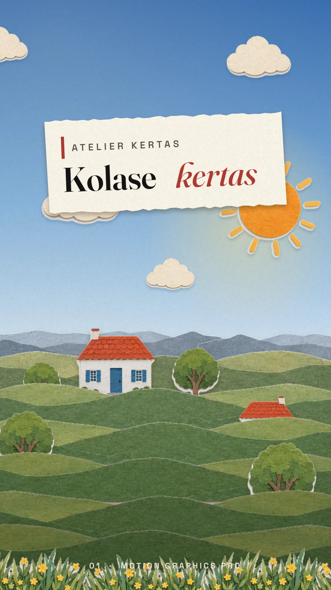</a> | **Atelier Kertas**<br>The house style: layered paper collage with depth, torn edges and soft paper shadows. | Paper blocks + the house-style rules, camera parallax in code. Local, 0 credits. |
| <a href="docs/assets/img/galeri/02-singapura-malam-preview.mp4">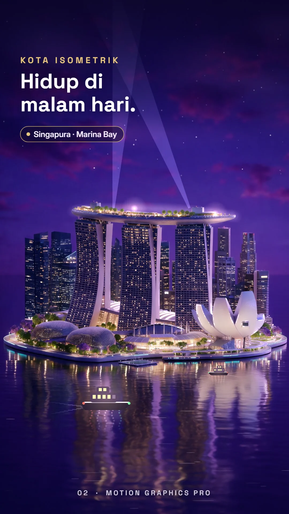</a> | **Night city**<br>An isometric Singapore-style skyline at night with lights that come alive. | One Higgsfield Seedream base image (2.5 credits); window lights, park lights, water reflections, boats and the camera push are all animated in code. |
| <a href="docs/assets/img/galeri/03-origami-preview.mp4">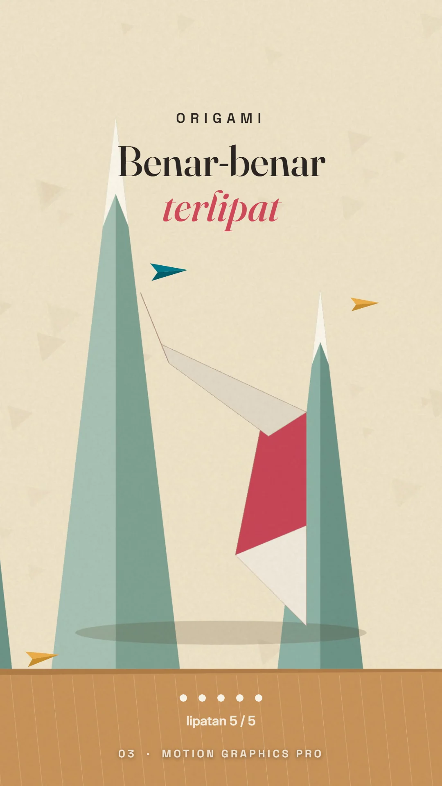</a> | **Origami**<br>A crane that really folds, panel by panel. | Pack TRN-03 + rigid-fold geometry (`MGP.foldPattern`, flat-foldability validator). Local. |
| <a href="docs/assets/img/galeri/04-pixel-art-preview.mp4">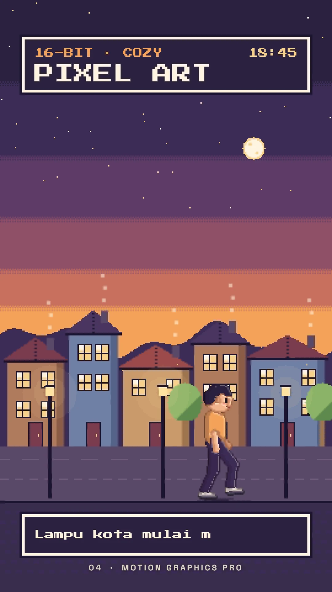</a> | **Pixel art**<br>A cozy 16-bit town with a walking character. | Pack TRN-02, pixel-snapped motion, everything drawn in code. Local. |
| <a href="docs/assets/img/galeri/05-teks-kinetik-preview.mp4">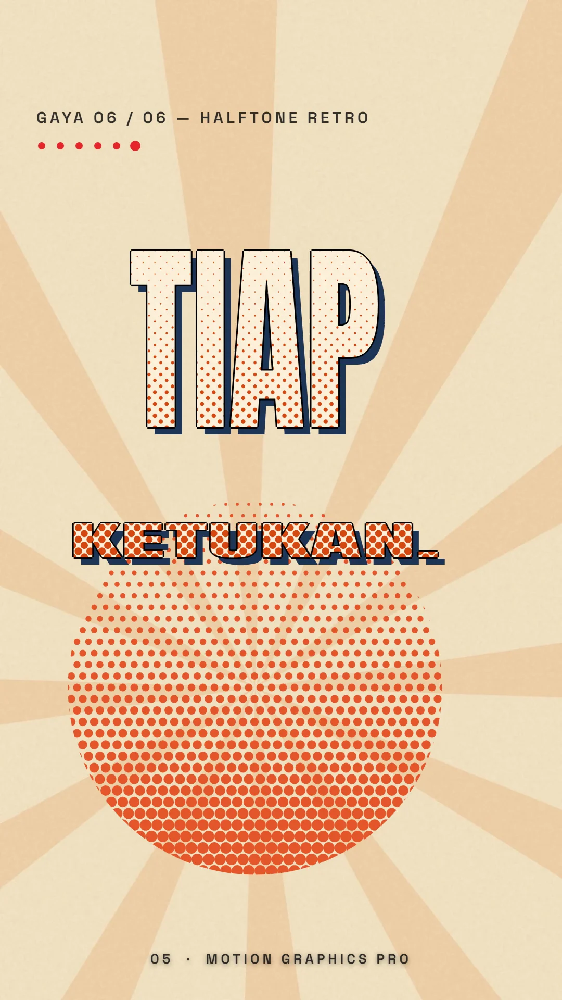</a> | **Kinetic type**<br>Six typography styles, switching on the beat. | KIN packs and text blocks (Swiss grid, neon, 3D extrude, handwriting, glitch, halftone), timed to the VO. Local. |
| <a href="docs/assets/img/galeri/06-peta-topografi-preview.mp4">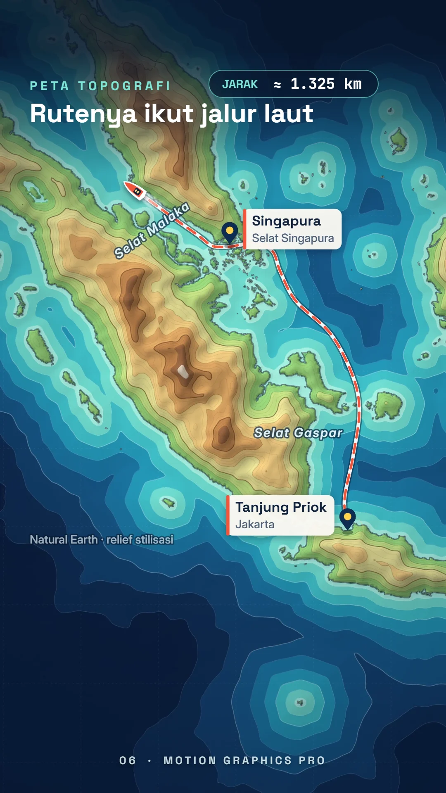</a> | **Topographic map**<br>Relief contours and a curved sea route instead of a straight line. | `MGP.map` on Natural Earth data, stylised contour relief, route following sea lanes. Local. |
| <a href="docs/assets/img/galeri/07-liquid-glass-preview.mp4">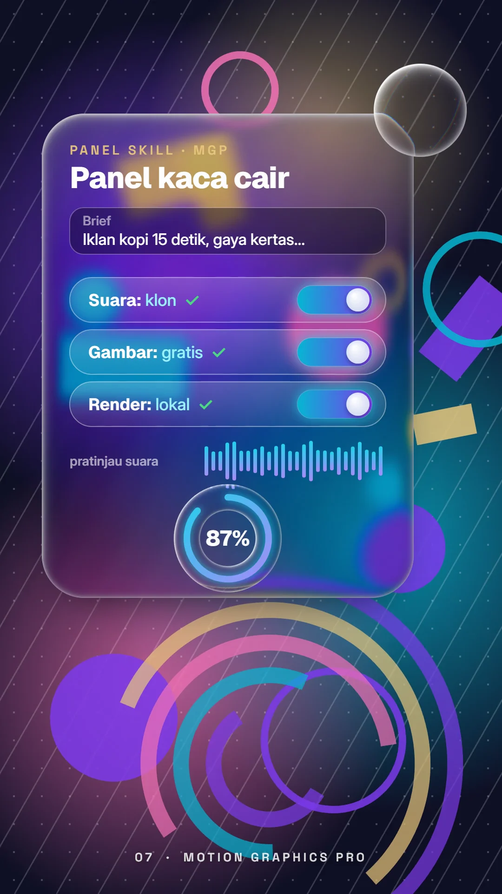</a> | **Liquid glass**<br>A glass control panel: brief typing, toggles, waveform, progress ring. | Pack ADS-03, per-pixel refraction on canvas, inertia wobble. Local. |
| <a href="docs/assets/img/galeri/08-tokoh-2d-preview.mp4">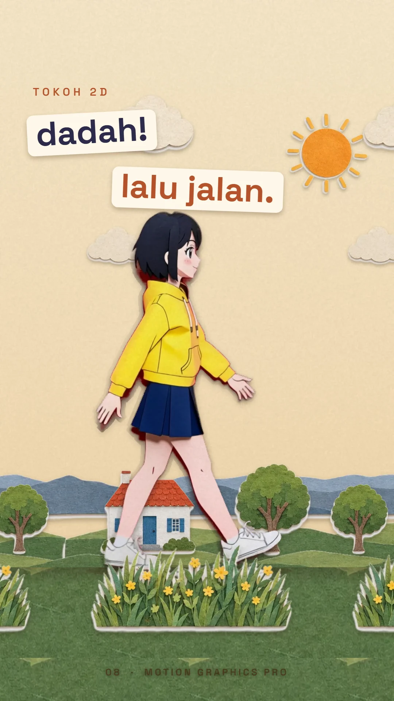</a> | **2D character**<br>The guide's paper girl waves, then walks over a paper parallax. | Character from local FLUX.2 images, animated with Kling (7.5 credits) on magenta, keyed, feet locked, eye colour corrected; parallax kit in code. |
| <a href="docs/assets/img/galeri/09-benda-bicara-preview.mp4"></a> | **Talking object**<br>A hopping coffee cup that speaks its line. | Local cup image, `MGP.chibiObject` squash and stretch, mouth shapes from per-letter VO timing (`MGP.lipsync`). Local. |
| <a href="docs/assets/img/galeri/10-simulasi-3d-preview.mp4">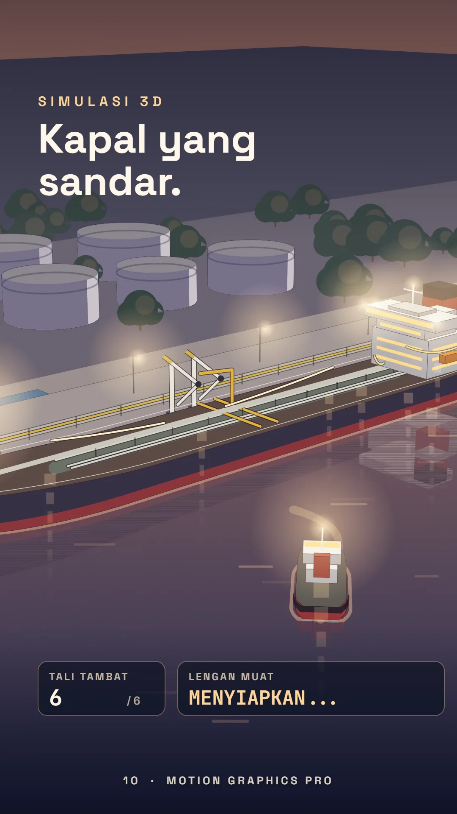</a> | **3D simulation**<br>A tanker docking in one continuous 3D camera take. | `MGP.sceneTanker` scene module, depth and shadows in code. Local. |
| <a href="docs/assets/img/galeri/11-talking-head-preview.mp4">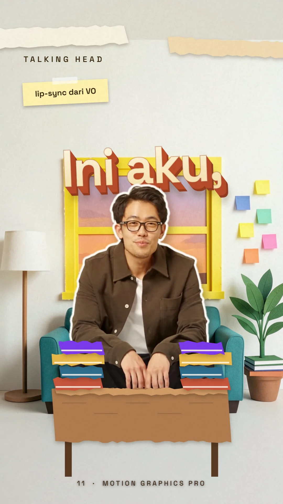</a> | **Talking head**<br>A real-looking presenter as a sticker cutout inside a paper world, shot from above and from the front. | Fictional person from Higgsfield (images + Intone lip-sync + Kling, 21 credits), cut out with `mgp cutout`, white sticker outline, paper set and 3D type in code. |
| <a href="docs/assets/img/galeri/12-hp-realistis-preview.mp4">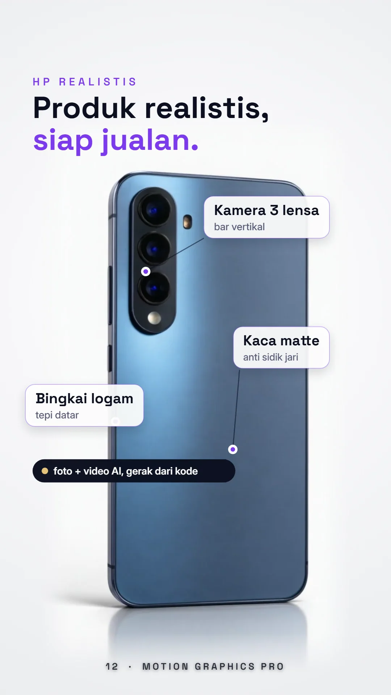</a> | **Realistic product**<br>A premium phone shot (no brand marks) with motion callouts. | Higgsfield product image + a 3-second Kling clip (≈5.5 credits); callouts, shine and UI tags in code. |

Full ads: [▶ 85-second product-demo ad](docs/assets/img/v24/iklan-85-demo.mp4) (narration: ElevenLabs v4 in the owner's cloned voice; 53 Higgsfield credits in total) · [▶ 30-second paper-collage ad](docs/assets/img/v24/iklan-30-v2.mp4) (local voice clone, 0 credits). More techniques are documented in [`motion-graphics/references/`](plugin/skills/motion-graphics/references/), with runnable pages in [`motion-graphics/lib/examples/`](plugin/skills/motion-graphics/lib/examples/).

## How to ask Claude

Basic pattern:

```text
I want a motion graphics [type of video] about [topic], [seconds] long,
ratio [9:16 / 16:9 / 1:1 / 4:5 / 21:9], in a [style] style. It shows [characters / objects / map / chart],
voice [ElevenLabs / my voice clone / my recording / no narration].
```

Real examples:

- **Ad**: *I want a 15-second 9:16 motion graphics ad for a bottled iced coffee, in a warm paper collage style. Show a coffee glass with a smiling face, kinetic text for its three strengths, then a logo reveal at the end. Use a friendly female voice-over.*
- **Explainer**: *Make a 60-second 16:9 explainer on how a savings app works, flat vector style. A vector character walks while explaining, transitions between steps have a reason, and the savings chart grows.*
- **Documentary**: *A 2-minute video essay on the spice route, layered paper-archive style, with a real map and a route that grows from Maluku to Venice, a calm male narrator, and a check before rendering.*
- **Music video**: *A 9:16 lyric music video for my song (lyrics attached), origami style, kinetic type on the beat, a slowly turning 3D camera, no AI assets.*
- **Education**: *A 45-second lesson for primary-school children on the water cycle, pixel art style. The character is a water droplet with a face that talks, bouncy motion, a child narrator's voice.*

Attach assets if you have them: a logo, product photos, lyrics or a recording of your voice.

## Motion pack library

104 packs in 11 categories. Each pack has its use, when to use it, length, key motion, palette, fonts, audio, blocks per slot (one `mgp add ... --into index.html` command), a copy-ready brief, and a moving scene (`MGP.packs.create(target, id)`). Browse them in the [guide](https://salimmoo.github.io/motion-graphics-pro/#paket), offline in `motion-graphics-pro/packs/motion-packs.html`, or read [`INDEX.md`](plugin/skills/motion-graphics-pro/packs/INDEX.md). The pack data (names and descriptions in `packs.json` and `motion-packs.html`) is still in Indonesian; `INDEX.md` gives the English name first.

## Comparison results

The in-house engines were tested side by side with the tools people usually use (06-11-2026, Core Ultra 7 165H laptop without a GPU, `--workers 2`). The comparison tools were installed only temporarily for testing and are not part of the package.

| Component | Compared with | Result | Figures |
|---|---|---|---|
| mgp (renderer) | HyperFrames | Near-identical, **2-3x faster** | Median PSNR 46.6-56.6, SSIM ≥ 0.9988; a 5-second MP4: 6.8 s vs 19.6 s |
| mgp.motion (animation engine) | GSAP 3.15 | On par | 4 of 7 compositions bit-identical; the one 1-frame offset found was fixed in v2.4.1 |
| brush (Python drawing) | Skia | Same quality, slower | PSNR 28-39 (differences almost only in text); 2-13x slower |
| image_ops (Python image processing) | OpenCV | Numerically identical, slower | 57/57 tests pass; resize is now 30-74x faster, still far behind OpenCV |
| Lottie player | lottie-web | Near-identical | Median PSNR 47, SSIM 0.9997 |
| `mgp align` (word timing) | faster-whisper | Different, no ground truth | Median difference 90-260 ms; tighter at pause edges |

## For contributors

- Shared Python modules are edited in `_shared/` only, then `python -I _shared/sync.py`; before a release `python -I _shared/sync.py --check` must pass.
- After editing a `lib/` module: `node motion-graphics/lib/build.js`.
- mgp tests: `cd motion-graphics-pro/render && npm run check-examples`; message catalogues: `node motion-graphics-pro/render/i18n/tools/keys.mjs --all`.
- Release (repo only, not packed): `python -I tools/build_plugin.py` stages the plugin in `dist_repo/plugin/` with `dist_repo/.claude-plugin/marketplace.json`, and writes `docs/download/motion-graphics-pro-plugin-v<version>.zip`; check it with `claude plugin validate --strict dist_repo/plugin`.

## Collaboration and support

Collaboration ideas, bug reports or requests for new styles: open an *Issue* in this repo, or use the channels in the **About** menu on the [site](https://salimmoo.github.io/motion-graphics-pro/). If this package helps you, support it through the **Donate** menu on the site (payment options are being added).

## Free and Ultra

Motion Graphics Pro is **free** and complete: everything in this repo (the plugin, `mgp`, all packs and blocks, the guide and the example previews) stays free. **Motion Graphics Ultra** is an optional paid edition for people who want to start from finished work.

| | **Pro (free, this repo)** | **Ultra (paid)** |
|---|---|---|
| Plugin with 3 skills, `mgp` CLI, local render | ✓ | ✓ |
| 104 motion packs, 260 blocks, motion library, guide | ✓ | ✓ |
| Preview videos of the ad and the 12 example clips | ✓ | ✓ |
| Editable source projects of the ad and all 12 clips | | ✓ |
| Premium packs and blocks | | ✓ |
| Early access to new versions, priority support | | ✓ |
| Team / commercial licence | | ✓ |

Ultra is delivered as access to a private GitHub repository. Availability and price will be announced on the [site](https://salimmoo.github.io/motion-graphics-pro/).

## Licence

[Motion Graphics Pro licence](LICENSE.md): free to use and modify for personal and client work, and you may sell the videos you make. The package itself may not be sold, redistributed or claimed as your own work. The models installed by `mgp install` (FLUX.2 [klein] 4B, Chatterbox) have their own licences, which allow commercial use.

## Acknowledgements

Motion Graphics Pro was written from scratch. It learned principles and ideas from the projects and research below and credits them openly. The tables show what was taken as a principle or idea, and what this package built on top. Full licence details: [NOTICE.md](NOTICE.md).

### Projects and tools

| Project (owner, licence) | Principles and ideas we follow | What Motion Graphics Pro built or improved (its own code) |
|---|---|---|
| **HyperFrames** (HeyGen, Apache-2.0) | The HTML composition format (`data-composition-*`, `data-start`, `data-duration`, `<template>` scenes, `window.__timelines`, `hf-seek`) so its compositions open unchanged; rendering by seeking a paused timeline frame by frame; a block registry installed as editable source (`add` / `catalog`), whose item list served as a coverage checklist | **mgp**, an independent renderer: 2-3x faster in our tests with near-identical output (median PSNR 46.6-56.6), its own browser-control client (no npm), 24 bundled fonts, scene styles scoped per sub-composition, renders that stop on script errors, parallel-safe capture with timeouts, frame-hash determinism checks, neutral names for every contract item. **260 blocks** rewritten with their own code, styles, props and English/Indonesian names. Plus Studio, `mgp audit`, `mgp curves`, voice cloning, free images, `mgp install` |
| **GSAP** (GreenSock / Webflow) | The shape of the public API (timeline, to/from/fromTo/set, position parameter, ease names), kept as a `gsap` alias so existing code runs | **mgp.motion**, its own tween engine: deterministic seek from any direction, spring presets with a damping ratio, inertia, delay chains; 227 tests |
| **OpenMontage** | Production-flow principles from its public research | The 9-step workflow with 5 decision gates, templates T1-T15 (EN + ID), blocking → spline stage, pre-render audit |
| **OpenCV** (Apache-2.0) | Documented algorithm behaviour: Suzuki-Abe contours, HSV table, INTER_AREA, Keys cubic, LINE_8 raster, connected components | **image_ops.py** in numpy + Pillow, numerically identical in 57/57 tests, resize 30-74x faster than its first version, no OpenCV needed |
| **Skia** (Google, BSD-3) | Compositing, blend-mode, stroke and fill-rule conventions | **brush.py**, a pure numpy vector engine (Skia optional), PSNR 28-39 against Skia |
| **Lottie** (format docs; lottie-web, MIT, used only as a test reference) | The Lottie JSON format: layers, transforms, keyframes, eases, shapes, masks | Its own player and exporter, `.lottie` output, keyframe and size reduction (81.6 → 52 MB JSON or 5.3 MB `.lottie` on the heaviest test) |
| **Chrome DevTools Protocol** (Chromium, BSD-3) / **Playwright** (Microsoft, Apache-2.0) | The protocol specification; a few Chrome launch defaults for identical results | Its own CDP client, crash and WebGL-loss detection, orphan-browser cleanup |
| **Rhubarb Lip Sync** | The A-H, X mouth-shape convention | Per-letter lip-sync from aligned VO timing that works for Indonesian (no English-only recogniser) |
| **Remotion** | Nothing taken; cited only as a comparison | — |

### Research

| Component | Used in | Source |
|---|---|---|
| The 12 principles of animation | Timing, squash and stretch, anticipation, overlap rules | F. Thomas & O. Johnston, *The Illusion of Life: Disney Animation* (1981) |
| The principles applied to 3D | 3D figure, camera moves | J. Lasseter, "Principles of Traditional Animation Applied to 3D Computer Animation", SIGGRAPH 1987 |
| Quaternion interpolation (SLERP) | Camera and joint rotations | K. Shoemake, "Animating Rotation with Quaternion Curves", SIGGRAPH 1985 |
| Damped springs and damping ratio | Presets `spring.bouncy / snappy / heavy` | Damped harmonic oscillator (classical mechanics) |
| Inertial bounce | `inertia()` | The After Effects inertial-bounce expression, popularised by Dan Ebberts |
| Miura-ori geometry | Miura fold block | M. Schenk & S. D. Guest, "Geometry of Miura-folded metamaterials", PNAS 2013 (pattern by K. Miura) |
| Flat-foldability | Origami pattern validator, rigid origami style | Maekawa-Justin and Kawasaki-Justin theorems |
| Facial Action Coding System | Faces of narrators and talking objects | P. Ekman & W. Friesen, FACS (1978) |
| Fields and effectors | `MGP.field` | The Cinema 4D MoGraph Fields concept (Maxon) |
| Border following | Contours in `image_ops.py` | S. Suzuki & K. Abe, "Topological structural analysis of digitized binary images by border following" (1985) |
| Cubic convolution | Image resize | R. Keys, "Cubic convolution interpolation for digital image processing" (1981) |
| Loudness | `mgp audio`, `mgp audit` | EBU R128 / ITU-R BS.1770 |
| Value and speed graphs | `mgp curves` | Graph-editor practice in After Effects and 3D packages |
| 2D/After Effects, 3D, origami and advanced-modelling notes | Advanced principles reference | Research notes compiled by the author (2026) |

### Data, fonts and models

| Item | Licence | Use |
|---|---|---|
| Natural Earth | Public domain | Coastlines, countries and cities in `MGP.map` |
| 24 Google Fonts families | SIL OFL 1.1 | Bundled for identical renders |
| Chatterbox Multilingual, OpenVoice V2 | MIT | Local voice clone (installed by `mgp install`, not bundled) |
| FLUX.2 [klein] 4B | Apache-2.0 | Local free images (installed, not bundled) |
| faster-whisper, U2-Net / rembg | MIT / Apache-2.0 | Transcripts and VO scoring; background removal (installed, not bundled) |

**Independent project.** Motion Graphics Pro is not affiliated with, endorsed by or sponsored by Anthropic, HeyGen, Remotion, GreenSock/Webflow, Higgsfield, ElevenLabs or any other company named here. Claude is a trademark of Anthropic, PBC. Other names are trademarks of their owners and are used only to describe compatibility, comparisons and credits. The chat window shown in the ads is a stylised illustration, not an official interface.

---

## Bahasa Indonesia

**Motion Graphics Pro** adalah tiga skill Claude untuk membuat video motion graphics dari brief sampai file video: explainer, iklan, music video, dokumenter, dan materi edukasi, bergaya kolase kertas, vektor, 3D, tipografi kinetik, pixel art, atau origami. Kamu cukup menulis brief seperti bicara ke tim kreatif; keputusan tetap di tanganmu di lima titik: konsep, naskah, biaya, contoh pertama, dan render.

- **Keunggulan.** Satu alur lengkap dari brief sampai render dengan 5 titik keputusan; semua lapisan bisa diubah (bukan template terkunci); 104 paket motion dan 260 blok dengan banyak gaya; klon suara sendiri atau ElevenLabs; gambar gratis lokal/cloud atau Higgsfield; cek mutu gerak (`mgp curves`) dan audit sebelum render (`mgp audit`); render di komputer sendiri tanpa langganan. Perbandingan lengkap: [Why Motion Graphics Pro](#why-motion-graphics-pro).
- **Bahasa.** Dokumen skill berbahasa Inggris, tetapi Claude membalas dalam bahasamu: pengguna Indonesia dilayani penuh dalam Bahasa Indonesia, termasuk brief T1, pesan gerbang, dan laporan (`references/template.id.md`). `mgp new --lang id` menulis `brief.md` dan `STATUS.md` dalam Bahasa Indonesia, dan `MGP_LANG=id` membuat pesan CLI berbahasa Indonesia. [Panduan interaktif](https://salimmoo.github.io/motion-graphics-pro/) tersedia dalam Bahasa Indonesia (bawaan) dan Inggris.
- **Mulai cepat.** `mgp new` → `mgp check` → `mgp add` → `mgp contact --times poses` (blocking) → `mgp curves` → `mgp audit` → `mgp render` (lihat [Quick start](#quick-start)).
- **Nama lama tetap jalan.** Sejak v2.4 perintah dan folder bernama Inggris (`rekam` → `mgp`, `blok/` → `blocks/`, `rujukan/` → `references/`, `proyek.json` → `project.json`, Gerak → `mgp.motion`). Nama lama berbahasa Indonesia (`rekam baru --rasio`, `rekam tambah … --ke`, `rekam pasang suara --latar`) tetap diterima sebagai alias, dan proyek lama tetap bisa dibuka dan dirender.
- **Gratis dan Ultra.** Semua isi repo ini tetap gratis dan lengkap. **Motion Graphics Ultra** (berbayar, opsional) menambah file proyek sumber iklan + 12 klip contoh yang bisa diedit, paket dan blok premium, akses versi baru lebih awal, dukungan prioritas, dan lisensi tim. Ultra diberikan lewat akses ke repo GitHub privat; ketersediaan dan harga diumumkan di situs. Lihat [Free and Ultra](#free-and-ultra).
- **Data paket motion** (`packs.json`, `motion-packs.html`) masih berbahasa Indonesia.

### Cara pasang (langkah demi langkah)

**A. claude.ai atau Cowork**
1. Unduh [ZIP plugin](docs/download/motion-graphics-pro-plugin-v2.4.2.zip) (±9,5 MB). **Jangan diekstrak.**
2. Buka **Settings → Capabilities**, pastikan **Code execution** aktif.
3. Buka **Customize → Plugins** → **Upload plugin** → pilih ZIP tadi. Bisa juga lewat **Add marketplace**, ketik `salimmoo/motion-graphics-pro`, lalu pasang **motion-graphics-pro**.
4. Buka chat baru dan tulis brief, misalnya *"Buatkan iklan 15 detik 9:16 gaya kolase kertas untuk es kopi"*.
5. Render video di chat claude.ai biasanya belum bisa, karena butuh Chrome dan ffmpeg. Untuk render, pakai Claude Code (jalur B).

**B. Claude Code**
1. Pasang **Node.js 22+**, **ffmpeg**, dan **Chrome/Edge** (plus Python 3.10+ untuk skrip Python).
2. Di Claude Code, ketik:
   ```text
   /plugin marketplace add salimmoo/motion-graphics-pro
   /plugin install motion-graphics-pro@salimmoo
   ```
3. Jalankan `/reload-plugins` atau buka sesi baru.
4. Cek dengan meminta *"jalankan mgp doctor"*, atau langsung tulis brief.
5. Opsional: pasang mesin lokal sekali per komputer, yaitu `mgp install voice --detach` (klon suara), `mgp install image --detach` (gambar gratis lokal), dan `mgp install cutout` (hapus latar).

Untuk memperbarui: `/plugin marketplace update salimmoo`. Untuk menghapus: `/plugin uninstall motion-graphics-pro@salimmoo`.

**C. Manual**
Salin tiga folder di `plugin/skills/` ke `~/.claude/skills/` (Windows: `%USERPROFILE%\.claude\skills\`), lalu jalankan `pip install -r ~/.claude/skills/motion-graphics/scripts/requirements.txt`.

**Kalau gagal:**
- *"Zip must contain a .claude-plugin/plugin.json"*: unggah lewat **Plugins**, bukan **Skills**, dan jangan ZIP ulang.
- *"too many files"*: itu batas unggah **skill** (200 file); pakai jalur plugin (maks 5.000 file).

Motion Graphics Pro adalah proyek independen, tidak berafiliasi dengan atau didukung oleh Anthropic maupun merek lain yang disebut. Claude adalah merek Anthropic.

© 2026 Salim Muhammad
